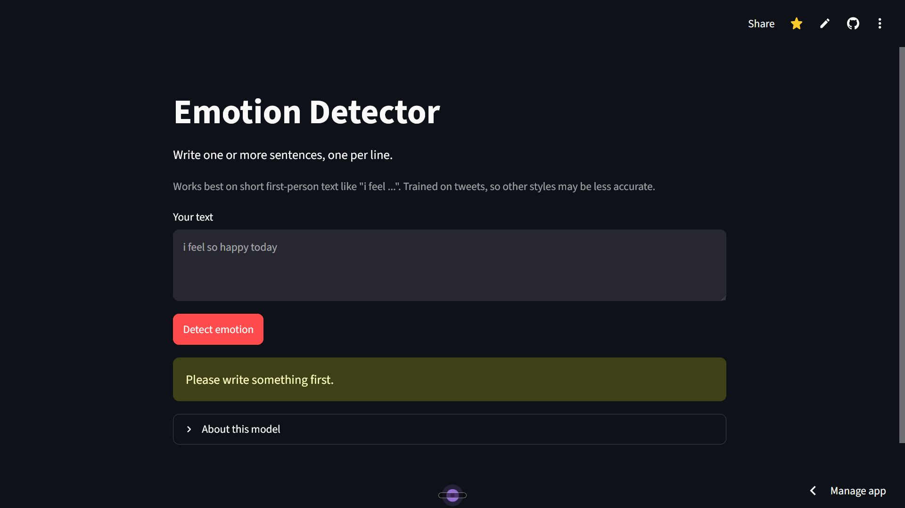
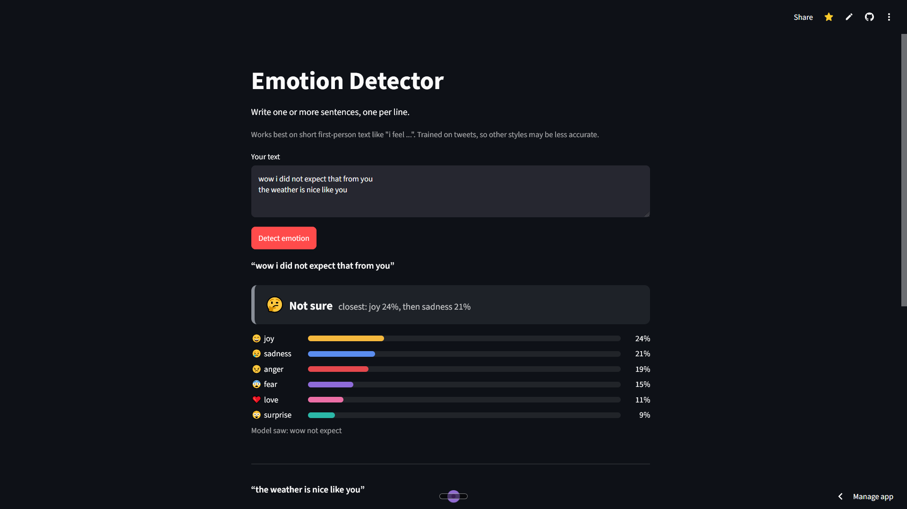

# Emotion Detector

Classifies short English text into 6 emotions: joy, sadness, anger, fear, love, surprise.

**Live demo:** https://emotion-detector-4u.streamlit.app/

## Results
| Version | Accuracy | Macro F1 |
|---|---|---|
| Baseline (TF-IDF + Logistic Regression) | 86.3% | 0.80 |
| + negations kept, one clean() function | 86.2% | 0.80 |
| + class_weight='balanced' | 88.5% | 0.85 |

Notebooks: [baseline](notebooks/01_baseline.ipynb) and [improved](notebooks/02_improved.ipynb)

## What I changed and why

I took this dataset from Kaggle. While working on it,
I noticed that the model was weak on two emotions,
love and surprise: it caught only 60% and 47% of them (recall).
I started with Logistic Regression on TF-IDF features as a baseline,
then added `class_weight='balanced'`, which raised their recall to 91% and 86%,
at the cost of lower precision (0.76 for love and 0.66 for surprise).
Overall accuracy rose from 86.3% to 88.5%, and macro F1 from 0.80 to 0.85.
I also kept negations such as "not" during stop-word removal, 
but it made no measurable difference (86.3% vs 86.2%).
The model counts words and does not understand word order,
so negations like "not happy" can still fool it.
It was trained on short tweets, and I have not tested it on long text.

## Limitations
- Trained on tweets, works best on short first-person text like "i feel ...".
- The model counts words and does not understand order, so "not happy" can still look happy.
- Balanced weights raised recall for love and surprise but lowered their precision.
- I compared models on the same test set, so the final number is slightly optimistic.

## Run locally
Python 3.12 is needed (scikit-learn 1.6.1 has no wheel for 3.14):

    py -3.12 -m venv venv
    .\venv\Scripts\python.exe -m pip install -r requirements.txt
    .\venv\Scripts\python.exe -m streamlit run app.py

## Data
https://www.kaggle.com/datasets/praveengovi/emotions-dataset-for-nlp?select=train.txt

## Author
**Tushar Bhardwaj** | [LinkedIn](https://www.linkedin.com/in/tushar-bhardwaj-b89973422) | [GitHub](https://github.com/highdreamers102)